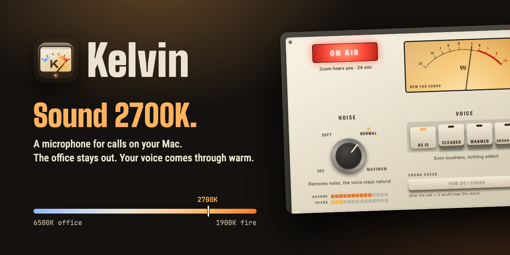

  

  <a href="https://kelvinmic.app"><b>Website</b></a> ·
  <a href="https://github.com/ilyabazhenov/kelvin/releases/latest/download/Kelvin.dmg"><b>Download for Mac</b></a> ·
  <a href="https://github.com/ilyabazhenov/kelvin/releases"><b>Releases</b></a>

**Kelvin is a microphone for calls on your Mac.** It removes background noise from your mic and
gives your voice a warm, close tone. Pick “Kelvin Mic” once in your call app, and it works in Zoom,
Google Meet, Microsoft Teams and anything else that lets you choose a microphone.

> **[Download Kelvin 1.0](https://github.com/ilyabazhenov/kelvin/releases/latest/download/Kelvin.dmg)** for macOS 14 or later on Apple Silicon.
> Open the download, drag Kelvin to Applications and pick “Kelvin Mic” in your call app.

## What it does

- **The office stays out.** Typing, air vents and mains hum disappear between your words. A neural
  noise suppressor (DPDFNet) runs on your Mac.
- **Your voice comes through warm.** Four Voice keys set the tone: As is, Clearer, Warmer and Broadcast.
- **One setting for every app.** Kelvin Mic is a regular system microphone, browser calls included.
- **You can hear yourself.** “How do I sound” records 6 seconds and plays them back, before and after.
  The VU meter shows how loud others hear you.
- **It stays on your Mac.** No account, and your voice never goes to a server.

## How it works

1. Install Kelvin. It asks for your mic once and adds “Kelvin Mic” to the system.
2. Pick “Kelvin Mic” in your call app's audio settings.
3. Talk. The lamp lights up **ON AIR** while an app hears you.

Kelvin needs **macOS 14 Sonoma** or later.

## Why “Kelvin”

Light colour is measured in kelvins: an office ceiling panel is about 6500K, a lamp at home 2700K,
firelight 1900K. Kelvin does the same for your voice, from the cold of an open-plan office to the
warmth of a fireside chat.

## This repository

The [kelvinmic.app](https://kelvinmic.app) website and, from the first version on, the releases.
The app's source code is not here.

The site is one static page, served by GitHub Pages from `main`: `index.html`, the voice samples in
`audio/` and two images. To preview it, run `python3 -m http.server` here and open http://localhost:8000.
